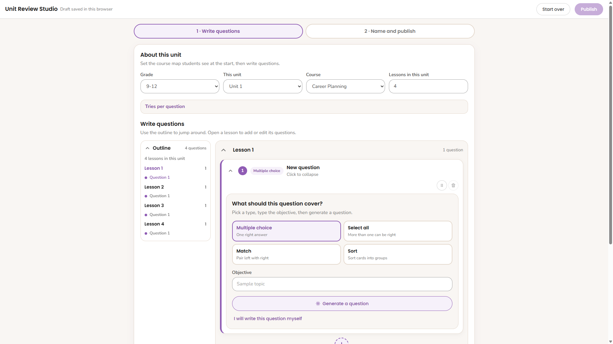
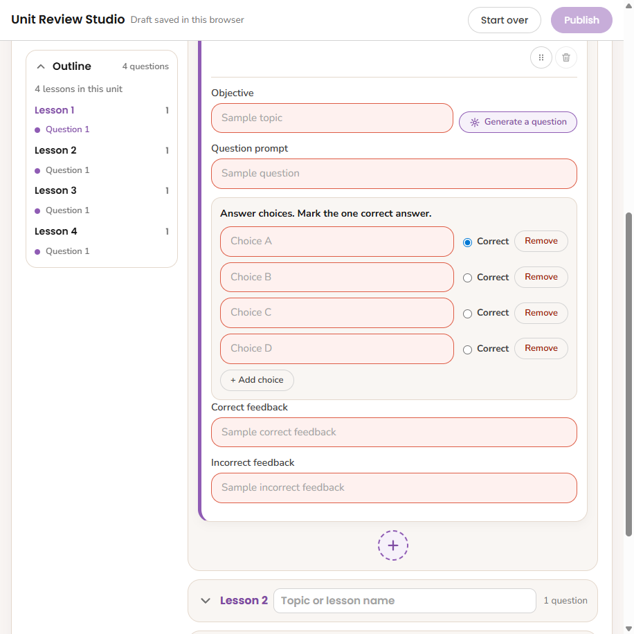
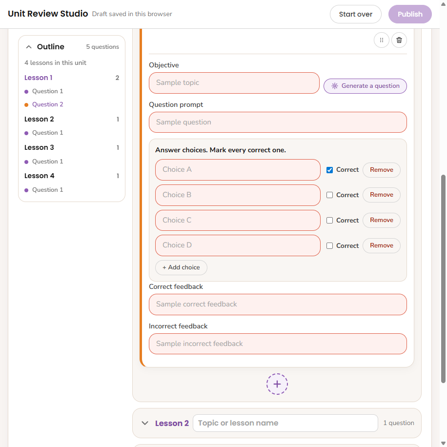
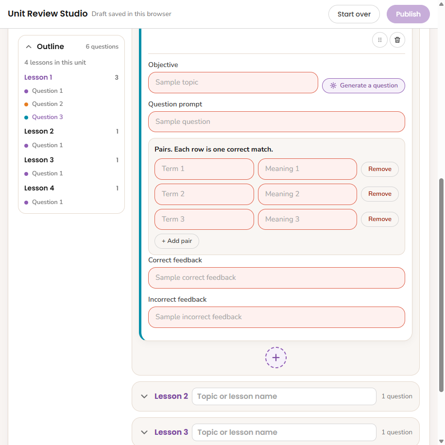
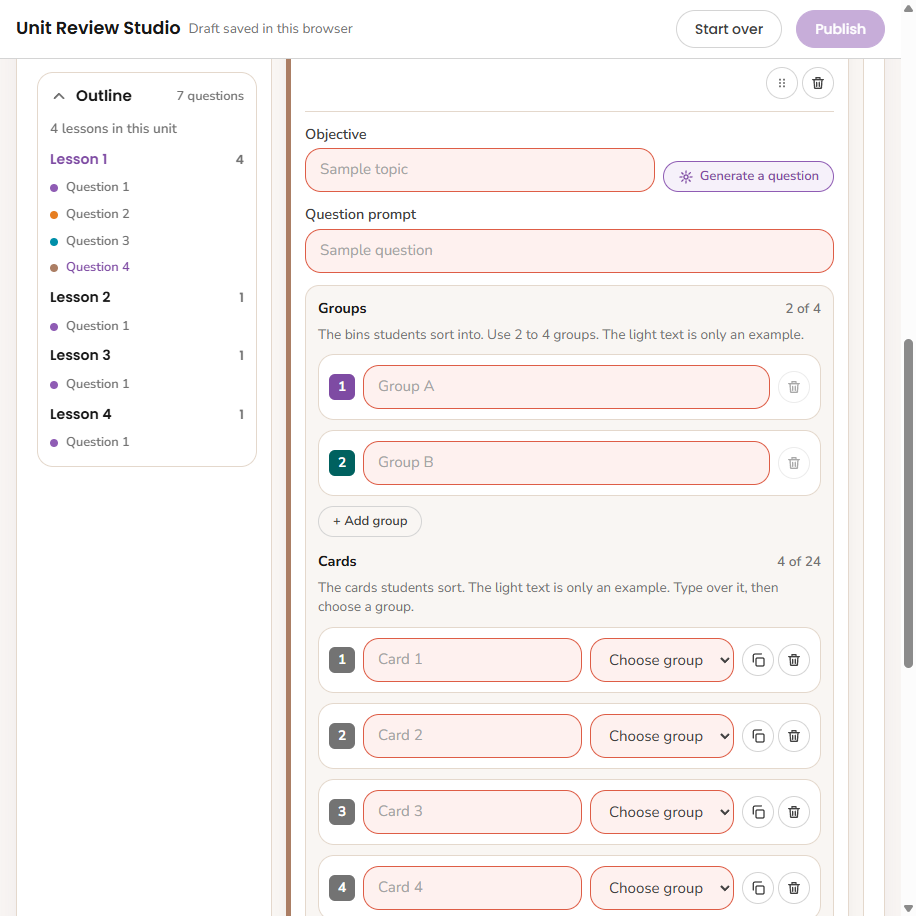
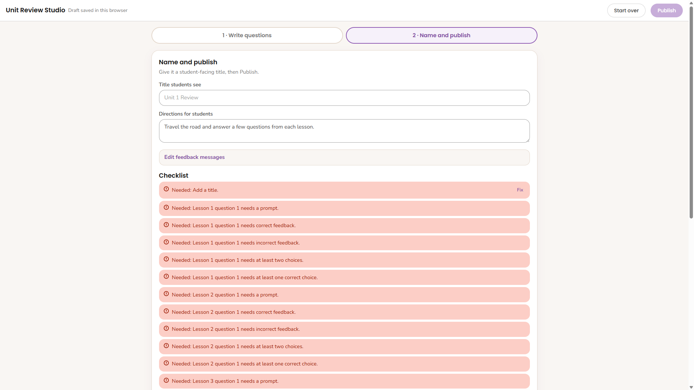
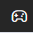
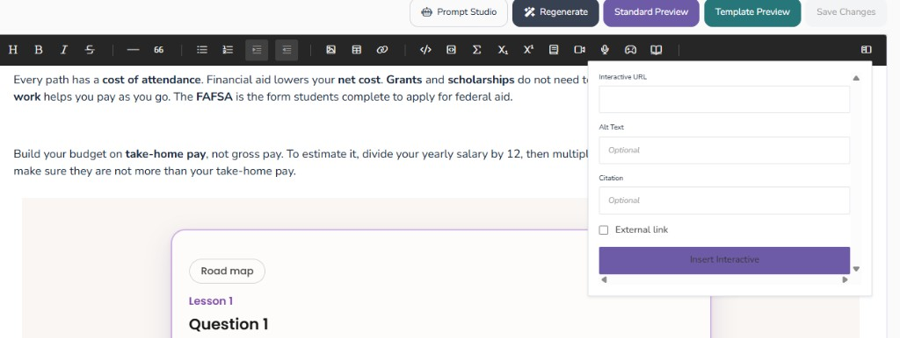

# Unit Review Studio guide

For curriculum developers building unit reviews in Unit Review Studio, then placing them in Course Builder.

**Studio**  
https://courtniestrongmind.github.io/Unit_Review_Studio/studio/

Open in Chrome or Edge. No coding required.

---

## Contents

- [Build in the studio](#build-in-the-studio)
- [Question types](#question-types)
- [Name and publish](#name-and-publish)
- [Put the review in Course Builder](#put-the-review-in-course-builder)
- [Checklist](#checklist)

---

## Build in the studio

Open the studio and click **Start**.

Under **About this unit**, set **Grade**, **This unit**, **Course**, and **Lessons in this unit**. That lesson count builds the road stops. Optional: open **Tries per question** if you want something other than 3.

### Vocabulary

Under **Vocabulary flashcards**, keep **Flashcards at the start** on unless you want to skip the warm-up.

Open each lesson and use **Vocabulary Match** to add that lesson’s words and meanings. Students see every unit word as flashcards before the road. When they enter a lesson, a short Match with that lesson’s words comes first, then your other questions. Put at least two words on a lesson if you want that Match to appear.

Use the **Outline** on the left to jump between lessons and questions. The preview on the right updates as you work.

Each lesson keeps a fixed **Lesson 1**, **Lesson 2** label. Next to it, type the topic or lesson name.

### Add a question

1. Open a lesson and add a question.
2. Pick a type, then use **Generate a question** (not currently ready) or **I will write this question myself**.
3. Fill in the objective, prompt, answers, correct feedback, and incorrect feedback.

Repeat for each lesson on the road. Keep tips short and clear.

---

## Question types

### Multiple choice

One right answer. Mark the correct choice.

### Select all

More than one can be right. Mark every correct choice with a checkbox.

### Match

Pair left with right. Each row is one correct match. Keep terms short enough to read at a glance. Students get a **Clear** button before Check.

### Sort

Name the groups, then assign each card to the correct group. Students sort cards into bins and can **Clear** before Check.

---

## Name and publish

Click **Name and publish**.

1. Set the **Title students see** and **Directions for students**.
2. Optional: edit shared feedback messages and the end message.
3. Read the **Checklist** and fix anything it flags.
4. Click **Publish**.

After you publish, copy the StrongMind interactives link. That is what you paste into Course Builder.

Click **Save draft** to keep your work if you refresh the tab. Closing the tab clears that draft. **Publish** is how you get the live link.

---

## Put the review in Course Builder

1. In Unit Review Studio, click **Publish** and copy the StrongMind interactives link.
2. Open the Course Builder page where the unit review should appear.
3. In the editor toolbar, click the **interactive** control (the game controller icon).

4. Paste the link into **Interactive URL**.
5. Add optional alt text if you want.
6. Click **Insert Interactive**.
7. Save the page and use preview to confirm the road loads.

---

## Checklist

- [ ] Course, unit, grade, and lesson count match the real unit
- [ ] Every lesson has at least one question
- [ ] Each question has clear correct and incorrect feedback
- [ ] Match and sort items are short and readable on a phone
- [ ] You played through once before publishing
- [ ] You copied the StrongMind interactives link after Publish
- [ ] Course Builder uses that link in an Insert Interactive block
- [ ] Course Builder preview shows the review correctly
