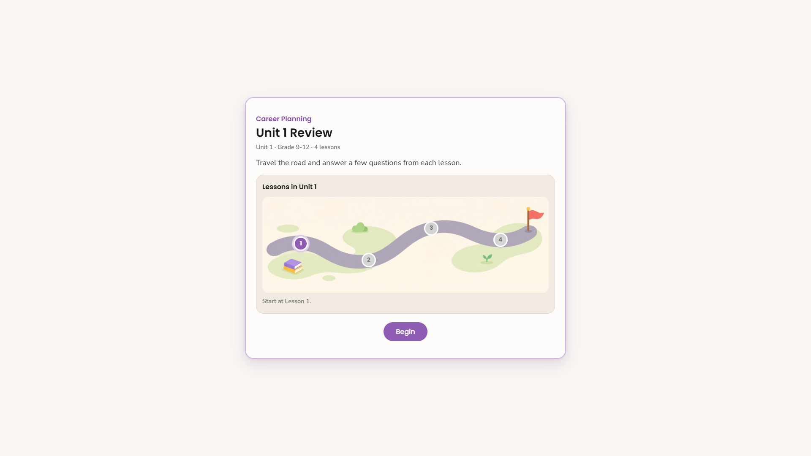
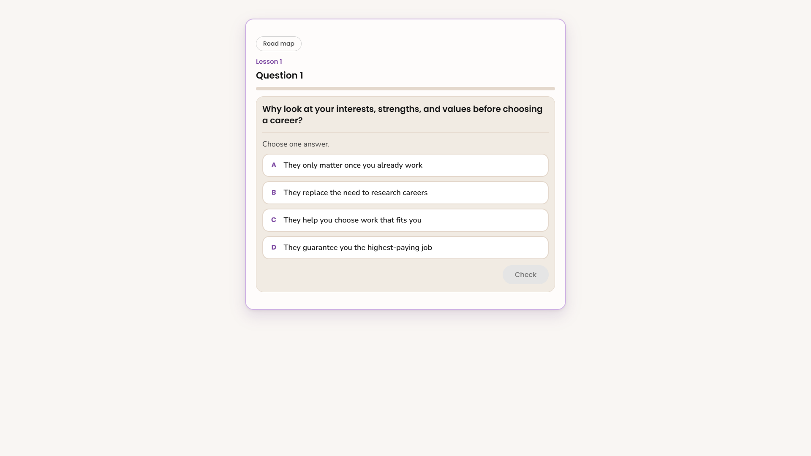
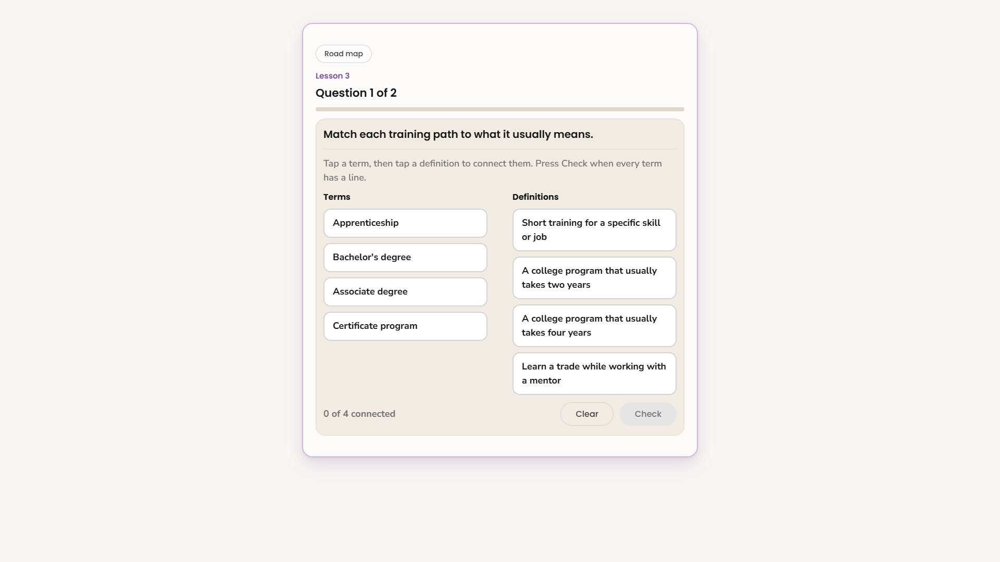
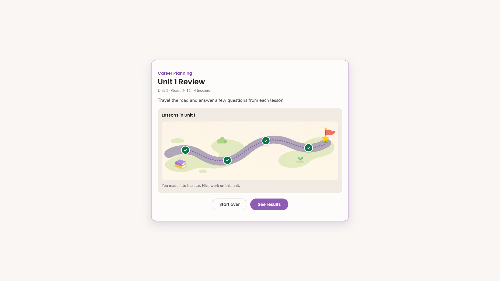
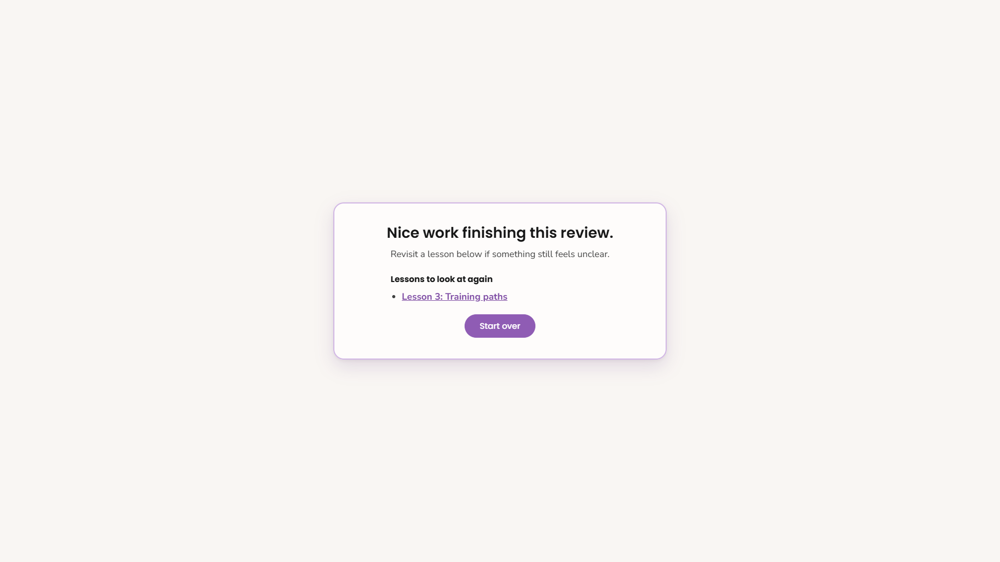

# Unit Review Studio developer guide

Self-serve resource for curriculum developers building unit review activities.

**Unit Review Studio** is the authoring tool. Students see a unit review on a lesson road.

You do not need to write code. You fill in the studio, preview as a student, then publish a zip into the repo.

---

## Links

Studio:  
https://courtniestrongmind.github.io/Unit_Review_Studio/studio/

Sample student view:  
https://courtniestrongmind.github.io/Unit_Review_Studio/review/index.html?set=sample-unit-review

Open these in Chrome or Edge.

Progress only lasts while the browser tab is open. Close the tab or use **Start over** on the road screen to begin at Lesson 1 again.

---

## What students get

Students travel a road of lessons for one unit.

1. They see the course name, unit title, short directions, and numbered stops.
2. They answer a few questions per lesson. Types can be multiple choice, select all, match, or sort.
3. They get a few tries. After a miss, they see a tip. Correct answers show short feedback.
4. When the dotted trail reaches the flag, a yellow star appears.
5. The end screen congratulates them. If anything was missed, it lists **Lessons to look at again** with the lesson number and name. Those names can link to Course Builder in a new tab.

### Student start / road

### A question

### Match with Clear

### Finished road

### End screen with lesson to revisit

---

## Before you build

Have ready:

- The course, grade, and unit number
- Lesson titles for that unit
- Rough ideas for the questions you want in each lesson
- Course Builder lesson links if you want the end screen to open those lessons

Try the sample student link once so you know the experience you are building.

---

## Build a review in the studio

### 1. About this unit and questions

Open the studio and click **Start**.

Under **About this unit**, set:

- **Grade**
- **This unit**
- **Course**
- **Lessons in this unit** (this builds the road stops)

Optional: open **Tries per question** if you want something other than 3 tries.

### 2. Name each lesson

Each lesson keeps a fixed **Lesson 1**, **Lesson 2** label. Next to it, type the topic or lesson name in its own box.

That topic helps authors stay oriented. Students mainly see numbered stops on the road. On the end-screen revisit list, topics show as **Lesson 3: Training paths**.

### 3. Add questions

1. Open a lesson and add a question.
2. Pick a type:
   - **Multiple choice** — one right answer
   - **Select all** — more than one can be right
   - **Match** — pair left with right
   - **Sort** — put cards into groups
3. Use **Generate a question** for a starting draft, or choose **I will write this question myself**.
4. Fill in objective, prompt, answers, correct feedback, and incorrect feedback.
5. Add a **Lesson URL** when you have the Course Builder link.
   - You only need the URL on one question in that lesson.
   - The end screen uses it for **Lessons to look at again**.
   - Links open in a new tab so the review stays open.

Repeat for each lesson on the road.

### Question-type tips

**Multiple choice / Select all**

- Keep choices short and parallel.
- Avoid making the longest choice the only correct one every time.
- For select all, mark every correct choice.

**Match**

- Keep left and right items short enough to read at a glance.
- Students connect pairs, then press Check.
- **Clear** removes unlocked connections.

**Sort**

- Name groups clearly.
- Assign each card to the correct group in the authoring view.
- Students sort cards into bins, then press Check.
- **Clear** sends unlocked cards back.

### 4. Name and publish

Click **Name and publish**.

1. Set the **Title students see** and **Directions for students**.
2. Optional: edit shared feedback lines and the end message.
3. Read the **Checklist** and fix anything it flags.
4. Click **Publish** and save the downloaded zip.

The studio also saves a draft in **that browser** automatically. Drafts do not sync to other computers. Publish is how you get the files that belong in the repo.

---

## Put it in the repo and ship it

1. Unzip the publish folder into `review/sets/`.
   - You should get something like `review/sets/my-activity-name/content.json`.
2. Activity folder names use lowercase letters, numbers, and dashes only.
3. Branch, commit, open a PR, merge, then run Dev Deploy and Prod Deploy the usual way.
4. Student link pattern after hosting is live:

`.../review/index.html?set=<activity-name>`

5. Embed that player URL in Helios in an iframe, same as other interactives.

Until the shared StrongMind interactives host is pointed at this repo, use the GitHub Pages links above for review.

---

## Ship checklist

- [ ] Course, unit, grade, and lesson count match the real unit
- [ ] Every road lesson has at least one question
- [ ] Each question has clear correct and incorrect feedback
- [ ] Match and sort items are short and readable on a phone
- [ ] Lesson URLs are added for lessons you want linked from the end screen
- [ ] You played the whole road once in preview or the published sample
- [ ] Publish zip is in `review/sets/` and named correctly
- [ ] Helios embed uses the player link with the right `?set=`

---

## Common questions

**Why did my review open on Lesson 2?**  
You already finished Lesson 1 in that same browser tab. Close the tab, use **Start over**, or open a fresh link.

**Where did my draft go?**  
Drafts live in local browser storage on that computer. Another browser or computer will not see them. Publish and save the zip if you need a lasting copy.

**Why is a lesson name on the end screen not a link?**  
That lesson has no Lesson URL on any of its questions yet. Add the Course Builder URL and publish again.

**Do students see points or a percent score?**  
No. This review is light. The focus is finishing the road and knowing which lessons to reopen.

**Can I change the player design later?**  
Yes, but that is a code change in `review/index.html`. After player edits, someone needs to run `python tools/build_studio.py` so the studio preview stays in sync.
